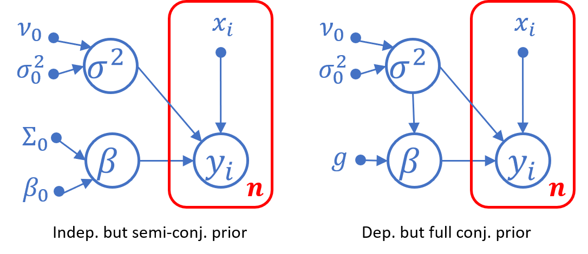
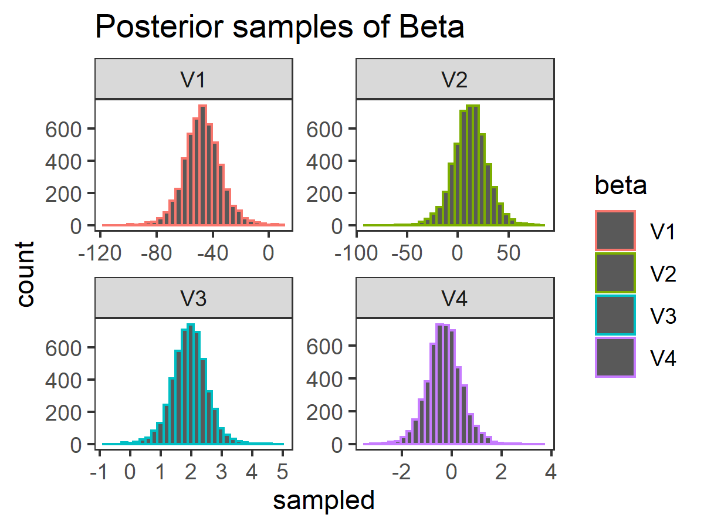
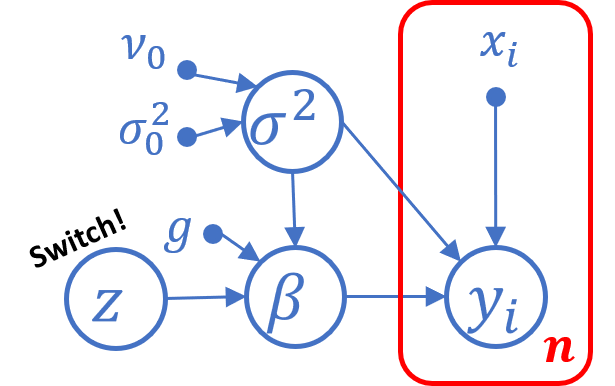
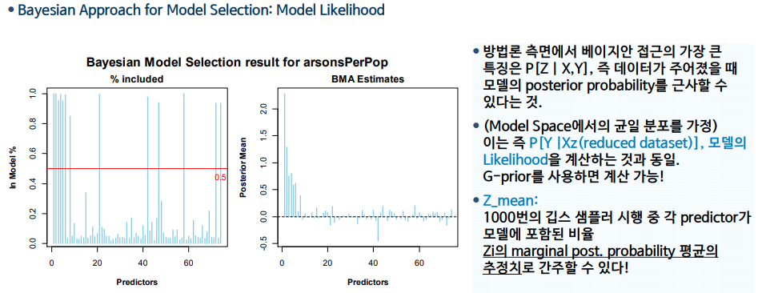
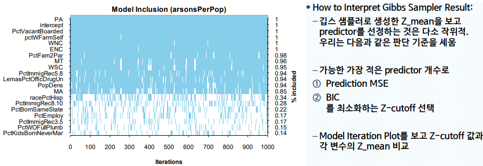
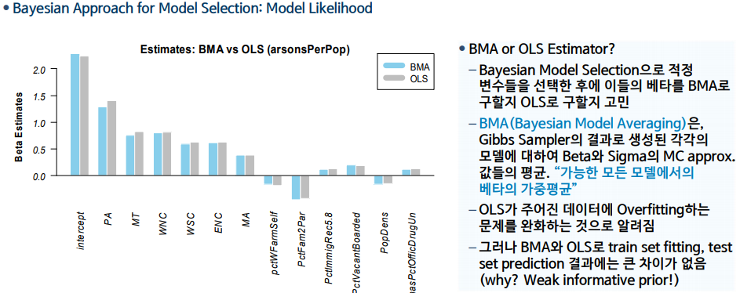

## Bayesian Linear Regression (FCB CH09, Hoff)

Gyeonghun Kang @hun_learning, Yonsei ESC, Feb 06, 2021

### Linear Regression Revisited

* Data: a target column $y\in(n\times 1)$, a design matrix $X=[x^{(1)}, x^{(2)}, ..., x^{(p)}] \in (n\times p)$

* Essence of LR Model =  **LINEAR CONDITIONAL MEAN** $E[y\mid x]$ 
  $$
  E[y_i \mid x_i] = \int y \,p(y\mid x)\,dx =\beta^Tx_i
  $$
  Normal LR model = linear $E[y\mid x]$ + **NORMAL ERROR** $\epsilon_i\sim N(0, \sigma^2)$
  $$
  y_i \sim N(\beta^Tx_i, \sigma^2)
  $$

* **Likelihood:** in MVN form,
  $$
  y \mid \beta,\sigma^2 \sim N(X\beta, \sigma^2I_n)\quad(\text{ith row of}\;X\beta=E[y_i \mid x_i])
  $$
  in a full density form,
  $$
  \begin{align}
  p(y\mid \beta, \sigma^2) &=\prod N(y_i;\beta, \sigma^2)=(\frac{1}{2\pi})^{n/2}(\frac{1}{\sigma^2})\exp \Big(-\dfrac{1}{2\sigma^2}\|y-X\beta\|^2_2\Big)
  \end{align}
  $$
  
* **Frequentist inference:** A single $\hat{\beta}$ optimized to the data (OLS = MLE for LR)

  Either by a vector derivative rule ($\frac{\partial}{\partial x}y^TAx=y^TA$, $\frac{\partial}{\partial x}x^TAx=x^T(A+A^T)$) or a projection theorem (LS sol to$Ax=y$ $\Leftrightarrow$ Sol to $A^TAx=A^Ty$), we have
  $$
  \hat{\beta}=\arg\max_\beta p(y\mid \beta,\sigma^2)=(X^TX)^{-1}X^Ty
  $$
  Since $\hat{\beta}$ a linear combination of $y \sim N()$, it is also $\sim N()$, and a bit of algebra reveals that the **sampling distribution** is
  $$
  \hat{\beta}\sim N(\beta, \sigma^2 (X^TX)^{-1} )
  $$
  with which we do inference such as interval estimation, hypothesis test and etc.


### Conjugacy: (nearly) all you need to know..

1. **Matching trick** for Normal family: $y\sim N(\mu,\Sigma)$, then
   $$
   \begin{align}
   p(y\mid \mu,\Sigma) &\propto \exp\Big(-\frac{1}{2}(y-\mu)^T\Sigma^{-1}(y-\mu)\Big)\\
   &\propto \cdots\\
   &\propto \exp\Big(-\frac{1}{2} y^T\Sigma^{-1}y + y^T\Sigma^{-1}\mu \Big)
   \end{align}
   $$
   so if $p(y) \propto \exp\Big(-\frac{1}{2} y^TAy + y^Tb \Big)$, then $E(y)=A^{-1}b,V(y)=A^{-1}$.

2. **Inverse Gamma pdf**: $\sigma^2 \sim \Gamma^{-1}(\nu_0/2, \sigma_0^2/2) = \chi^{-2}(\nu_0, \nu_0\sigma_0^2)$ then,
   $$
   p(\sigma^2 \mid \nu_0, \sigma_0^2) = \dfrac{(\nu_0 \sigma_0^2/2)^{\nu_0/2}}{\Gamma(\nu_0/2)}(\dfrac{1}{\sigma^2})^{\nu_0+1}\exp\Big(-\dfrac{\nu_0\sigma_0^2}{2\sigma^2}\Big)
   $$
   


### Bayesian Treatment of Linear Regression 

Full prob. model: $p(y,\beta,\sigma^2)=\underbrace{p(\beta,\sigma^2)}_{how?}p(y \mid \beta,\sigma^2)$ 



1. Semi-conjugate, independent prior: 
   $$
   \begin{align}
   p(y,\beta,\sigma^2)&=\Big[p(\beta)p(\sigma^2)\Big]p(y \mid \beta,\sigma^2)\\
   \beta &\sim N(\beta_0, \Sigma_0)\\
   \sigma^2 &\sim \Gamma^{-1}(\nu_0/2, \nu_0\sigma_0^2/2)
   \end{align}
   $$

2. Full-conjugate, dependent prior: 
   $$
   \begin{align}
   p(y,\beta,\sigma^2)&=\Big[p(\sigma^2)p(\beta\mid \sigma^2)\Big]p(y \mid \beta,\sigma^2)\\
   \beta\mid \sigma^2 &\sim N(0, g\sigma^2(X^TX)^{-1}) \quad \textbf{g-prior!}\\
   \sigma^2 &\sim \Gamma^{-1}(\nu_0/2, \nu_0\sigma_0^2/2)
   \end{align}
   $$


### Posterior for semi-conjugate prior

**Slopes posterior** $\beta\mid y,\sigma^2 \sim N(\beta_n, \Sigma_n)$

With $\beta \sim N(\beta_0, \Sigma_0)$ prior and $y\mid \beta, \sigma^2 \sim N(X\beta, \sigma^2)$ likelihood, and **known $\sigma^2$,** we have 
$$
\begin{align}
p(\beta\mid y,\sigma^2) &\propto p(y\mid \beta, \sigma^2)p(\beta)\\
&\propto\exp\Big(-\dfrac{1}{2\sigma^2}(y^Ty-2\beta^TX^Ty+\beta^TX^TX\beta) -\dfrac{1}{2}(\beta^T\Sigma_0^{-1}\beta - 2\beta^T\Sigma_0^{-1}\beta_0)\Big)\\
&\propto\exp\Big( -\frac{1}{2}\beta^T \underbrace{\big(X^TX/\sigma^2 + \Sigma_0^{-1}\big)}_{\Sigma_n^{-1}}\beta + \beta^T\underbrace{\big(X^Ty/\sigma^2+\Sigma_0^{-1}\beta_0\big)}_{\Sigma_n^{-1} \beta_n} \Big)\\
\therefore \Sigma_n^{-1}&= \underbrace{X^TX/\sigma^2}_{\text{data precision}} + \underbrace{\Sigma_0^{-1}}_{\text{prior precision}},\quad\beta_n = \Sigma_n(X^Ty \underbrace{/\sigma^2}_\text{data weight}+\underbrace{\Sigma_0^{-1}}_\text{prior weight}\beta_0)
\end{align}
$$
for $|\Sigma_0^{-1}|<\epsilon$ (weak prior), $\beta_n \approx \hat{\beta}_{mle}$. Don't want the bias from $\beta_0$? Choose $\beta_0=0,\Sigma_0=g\sigma^2(X^TX)^{-1}$, then $\beta\mid y,\sigma^2 \sim N\Big(\frac{g}{g+1}\hat{\beta}_{mle}, \frac{g}{g+1}V(\hat{\beta}_{mle})\Big)$ $\to$ **g-prior!** (Higher g means a weaker prior)

**Error Variance posterior** $\sigma^2\mid y, \beta \sim \chi^{-2}(\nu_n, \sigma_n^2)$ 

Let $SSR(\beta)=\|y-X\beta\|_2^2$ (sum of squares incurred by $\beta$), then
$$
\begin{align}
p(\sigma^2 \mid y, \beta)&\propto p(\sigma^2)p(y \mid \beta, \sigma^2)\\
&\propto (\dfrac{1}{\sigma^2})^{\nu_0/2+1}\exp(-\dfrac{\nu_0\sigma_0^2}{2\sigma^2})
(\dfrac{1}{\sigma^2})^{n/2}\exp(-\frac{SSR(\beta)}{2\sigma^2})\\
&=(\dfrac{1}{\sigma^2})^{(\nu_0+n)/2+1}\exp(-\dfrac{\nu_0\sigma_0^2+SSR(\beta)}{2\sigma^2})\\
\therefore\quad& \nu_n =\nu_0+n \quad \text{prior+data (pooled) sample size}\\
& \sigma_n^2=(\nu_0\sigma_0^2+SSR(\beta))/\nu_n \quad \text{pooled variance}
\end{align}
$$
**Joint posterior $\beta, \sigma^2\mid y$ ?**

Analytically intractable, but with full conditional posteriors, we can use Gibbs sampler!

1. with initial estimate, sample $\sigma^2 \sim \chi^{-2}(\nu_n, \sigma_n^2)$
2. with the sample from 1, sample $\beta \sim N\Big(\frac{g}{g+1}\hat{\beta}_{mle}, \frac{g}{g+1}V(\hat{\beta}_{mle})\Big)$ 
3. Repeat 1~2 a lot, ditch the first half, use the rest for posterior inference


### Code example

```{r}
DF = dget('http://www2.stat.duke.edu/~pdh10/FCBS/Inline/yX.o2uptake')
y = DF[,1]; X = DF[,-1]; inv = solve
### set prior and get necessary statistics
g = length(y) # g-prior for beta
nu0 = 1; s20 = summary(lm(y~-1+X))$sigma^2 # prior for sig^2
n = length(y); p = ncol(X)
### MCMC setup
S = 10000; set.seed(0827)
BETA = matrix(NA, nrow=S, ncol=p)
sigma2 = matrix(NA, nrow=S, ncol=1)
BETA[1,] = inv(t(X) %*% X) %*% t(X) %*% y # initial estimate
sigma2[1,] = s20 # initial estimate
### gibbs sampling
nun = nu0 + n
betan = (g/(g+1)) * inv(t(X) %*% X) %*% t(X) %*% y
for(s in 2:S){
  s2n = nu0*s20 + t(y- X %*% BETA[s-1,]) %*% (y- X %*% BETA[s-1,])
  sigma2[s,] = 1/rgamma(1, shape = nun/2, rate = s2n/2)
  
  Sigman = (g/(g+1)) * sigma2[s,] * inv(t(X) %*% X)
  BETA[s,] = MASS::mvrnorm(n=1,betan, Sigman) }
```




### Posterior for full-conjugate prior

$$
p(\beta,\sigma^2\mid y)=\underbrace{p(\sigma^2\mid y)}_\text{??}\, \underbrace{p(\beta\mid \sigma^2, y)}_\text{posterior of g-prior}
$$

where $p(\sigma^2\mid y)\propto p(\sigma^2) p(y\mid \sigma^2)$. 

Let $m, V$ be post. mean and var. of $\beta\mid \sigma^2, y$  $(m=\frac{g}{g+1}(X^TX)^{-1}X^Ty, \, V=\frac{g}{g+1}\sigma^2(X^TX)^{-1})$
$$
\begin{align}
p(y\mid \sigma^2) &\propto \int p(y\mid \beta, \sigma^2)p(\beta \mid \sigma^2)\,d\beta\\
&\propto (\frac{1}{\sigma^2})^{n/2}\dfrac{1}{|g\sigma^2(X^TX)^{-1}|^{1/2}} \int 
\exp\Big[-\frac{1}{2\sigma^2}\big(\|y-X\beta\|^2\big)-\frac{1}{2g\sigma^2}\beta^TX^TX\beta\Big]\,d\beta\\
&= (\frac{1}{\sigma^2})^{n/2}\dfrac{1}{|g\sigma^2(X^TX)^{-1}|^{1/2}} \exp\big[-\frac{1}{2\sigma^2}y^Ty\big]
\int \exp\Big[ \frac{1}{\sigma^2}\beta^TX^Ty -\frac{1+1/g}{2\sigma^2}\underbrace{\beta^TX^TX\beta}_{\text{subtract } m\text{ from }\beta\text{, use V}}\Big]\,d\beta\\
&= (\frac{1}{\sigma^2})^{n/2}\dfrac{1}{|g\sigma^2(X^TX)^{-1}|^{1/2}} \exp\Big[-\frac{1}{2\sigma^2}\big(y^Ty -\sigma^2m^TV^{-1}m\big)\Big]
\int \exp\Big[ -\frac{1}{2}(\beta -m)^TV^{-1}(\beta-m) \Big]\,d\beta\\
&\propto (\frac{1}{2\pi})^{n/2}(1+g)^{-p/2}  (\frac{1}{\sigma^2})^{n/2}\exp\Big[-\frac{1}{2\sigma^2}SSR(g)\Big]\\
\end{align}
$$
where $SSR(g) = y^Ty -\sigma^2m^TV^{-1}m = y^T\big(I - \frac{g}{g+1}X(X^TX)^{-1}X^T\big)y$ is a sum of squares, over all possible $\beta \mid \sigma^2,y$, incurred by g. Note that as $g\to \infty$ (weak prior), $SSR(g)\to SSR(\hat{\beta}_{mle})$.

Therefore, with $\sigma^2 \sim \chi^{-2}(\nu_0, \sigma_0^2)$, we have $\sigma^2 \mid y \sim \chi^{-2}(\nu_0+n,\frac{\nu_0\sigma_0^2+SSR(g)}{\nu_0+n})$
$$
\begin{align}
p(\sigma^2\mid y)&\propto p(\sigma^2) p(y\mid \sigma^2)\\
&\propto (\frac{1}{\sigma^2})^{(\nu_0+n)/2+1}\exp\Big(-\frac{\nu_0\sigma_0^2+SSR(g)}{2\sigma^2}\Big)
\end{align}
$$
With the full conjugate posterior, sampling $\beta,\sigma^2 \mid y$ is DIRECT and straightforward;

1. sample $\sigma^2 \sim \chi^{-2}(\nu_0+n,\frac{\nu_0\sigma_0^2+SSR(g)}{\nu_0+n})$
2. sample $\beta\mid \sigma^2 \sim N\Big(\frac{g}{g+1}\hat{\beta}_{mle}, \frac{g}{g+1}V(\hat{\beta}_{mle})\Big)$
3. use sampled $(\sigma^2,\beta)$ for posterior inference directly.

<span style="color:red">**CONJUGACY SEEMS MUCH HAIRY, BUT STILL FAR BETTER THAN MCMC!**</span>


### Bayesian Model Selection (*)

(Frequentist MS? Combinatorial Optimization using a single metric e.g. AIC.)

**IDEA**: introduce $z_j\in\{0,1\}$ which decides whether $\beta_j=z_i\cdot b_j\neq0$ (i.e. included) or not.
$$
\begin{align}
\text{Single data model} &\quad y_i = z_1b_1x_{i,1} + z_2b_2x_{i,2} + ... + z_pb_px_{i,p}+\epsilon_i\\
\text{Full prob. model} &\quad p(y,\beta,\sigma^2,z)=p(z)p(\sigma^2)p(\beta\mid \sigma^2,z)p(y\mid \beta,\sigma^2)
\end{align}
$$


Bayesian Model Selection is to get a dist. of the "switch" variable $z$ given $y$. <span style="color:red">Remember, Bayes MS does NOT give a **single** optimal model, but **many** "probable" models!</span> How do we get a posterior for $z$? Bayes rule always!

$$
p(z\mid y) = \dfrac{p(z)p(y\mid z)}{\sum_zp(z)p(y\mid z)} \quad \textit{intractable denominator}
$$
Note that $p(z\mid y) \propto p(z)p(y\mid z)$ is $\propto p(y\mid z)$ with uniform $p(z)$, so we only need $p(y\mid z)$. Let $\beta_z$ be $\beta_j$s with $z_j=1$, likewise for $X_z, p_z$ , and $p(\sigma^2)\propto 1/\sigma^2$.

$$
\begin{align}
p(y\mid z)&= \int \int p(y, \beta, \sigma^2\mid z)\,d\beta \, d\sigma^2\\
&= \int p(\sigma^2) \underbrace{\int p(y\mid \beta_z, \sigma^2)p(\beta_z\mid \sigma^2) \,d\beta}_{p(y\mid \sigma^2, z)} \, d\sigma^2\\
&\propto (1+g)^{-p_z/2}\int  (\frac{1}{\sigma^2})^{n/2+1}\exp\Big[-\frac{SSR(g,z)}{2\sigma^2}\Big] \, d\sigma^2\\
&\propto (1+g)^{-p_z/2}SSR(g,z)^{-n/2}\\
&\quad \Big(\because p(y\mid \sigma^2)\propto (\frac{1}{2\pi})^{n/2}(1+g)^{-p/2}  (\frac{1}{\sigma^2})^{n/2}\exp\Big[-\frac{1}{2\sigma^2}SSR(g)\Big]\Big)
\end{align}
$$
The Bayes factor is as below, which shows that Bayesian MS 1) favors a model that explains the data well (SSR) but 2) penalizes a complex model (p) at the same time.
$$
\dfrac{p(y\mid z_1)}{p(y\mid z_2)}=(1+g)^{(p_2-p_1)/2}\Big(\frac{SSR(g,z_2)}{SSR(g,z_1)}\Big)^{n/2}
$$


### Gibbs Sampler for Bayesian Model Selection

G.Sampler for $p(z\mid y)$ requires full conditional distribution
$$
\begin{align}
p(z_j=1\mid y, z_{-j}) &= \dfrac{p(z_j=1\mid y, z_{-j})}{p(z_j=1\mid y, z_{-j})+(z_j=0 \mid y, z_{-j})}= \dfrac{1}{1+o_j}
\end{align}
$$
where $o_j = \frac{p(z_j=0\mid y, z_{-j})}{p(z_j=1 \mid y, z_{-j})}$ is the conditional odds that $z_j=1$ , which is a ratio of $p(y\mid z)$;
$$
o_j = \dfrac{p(z_j=0\mid y, z_{-j})}{p(z_j=1 \mid y, z_{-j})} = \dfrac{p(z_j=0)}{p(z_j=1)}\times
\dfrac{p(y\mid z_{-j}, z_j=0)}{p(y\mid z_{-j}, z_j=1)}=\dfrac{p(y\mid z_{-j}, z_j=0)}{p(y\mid z_{-j}, z_j=1)}
$$
The Gibbs sampler for Bayesian MS is, given initial $\{z^{(s)}, \sigma^{(s)}, \beta^{(s)}\}$,

1. Update $z$: for each $j$, replace $z_j = 1-z_j$ with probability $1/(1+o_j)$. 
2. Given $z$, draw $\sigma^2\sim p(\sigma^2 \mid z, y)$ and $\beta \sim p(\beta \mid \sigma^2, y)$

**Code example**

```{r}
lpy = function(y, X, g = length(y), nu0 = 1, s20 = try(summary(lm(y~-1+ X))$sigma^2, silent=T)){
  n = nrow(X); p = ncol(X);
  if(p==0) Hg = 0; s20 = mean(y^2) # null model
  if(p > 0) Hg = (g/(g+1)) * X %*% inv(t(X) %*% X) %*% t(X)
  SSRg = t(y) %*% (diag(1, n) - Hg) %*% y
  return( -p/2 * log(1+g) - n/2 * log(SSRg) ) } # log p(y \mid z)
z = rep(1, ncol(X)) # MCMC setup
lpy.c = lpy(y, X[, z==1, drop=F])
S = 1000; Z = matrix(NA, S, ncol(X))
for(s in 1:S){# Gibbs sampler
  for(j in sample(1:ncol(X))){ # iterate over variables randomly
    zp = z; zp[j] = 1-zp[j]
    lpy.p = lpy(y, X[, zp==1, drop=F])
    o = (lpy.p - lpy.c) * (-1)^(zp[j] == 1)
    z[j] = rbinom(1, 1, 1/(1+exp(o))) # full cond. dist of zj
    if(z[j] == zp[j]) lpy.c = lpy.p }
  Z[s,] = z; if(s %% 100 == 0) cat(s, "\t") }
```


### Code Example: a bit tricky?

The Gibbs sampling part for the previous code block is a bit tricky to understand, so here is what is going on under the hood.

With ``for(j in sample(1:ncol(X)))``, we would select an element  of $z$, say $z_j$, which could be either $z_j=0, 1$. `zp` is a copy of the current model of which $z_j$ would be switched, i.e. $z_j=1 \to 0$ or $z_j=0\to1$, by the code `zp[j]=1-zp[j]`. 

`lpy.p` is the log likelihood of the model whose $z_j$ is switched, and we would compare this with the unswitched one `lpy.c`, to determine $o_j = \frac{p(y\mid z_{-j}, z_j=0)}{p(y\mid z_{-j}, z_j=1)}$. The catch is that, for each case, the variables `lpy.c` and `lpy.p` takes on opposing values, so we need `o = (lpy.p - lpy.c) * (-1)^(zp[j] == 1)` to adjust this difference.

1.  $z_j=1 \to 0$ `zp[j]==0`
   $$
   \begin{cases}
   lpy.c=p(y\mid z_j=1)\\
   lpy.p=p(y\mid z_j=0) 
   \end{cases} \quad \therefore
   p(z_j=1\mid y,z_{-j})=\dfrac{1}{1+\frac{p(y\mid z_{-j}, z_j=0)}{p(y\mid z_{-j}, z_j=1)}}=\dfrac{1}{1+\exp(lpy.p-lpy.c)}
   $$
   
2. $z_j=0\to1$ `zp[j]==1`
   $$
   \begin{cases}
   lpy.c=p(y\mid z_j=0)\\
   lpy.p=p(y\mid z_j=1) 
   \end{cases} \quad \therefore
   p(z_j=1\mid y,z_{-j})=\dfrac{1}{1+\frac{p(y\mid z_{-j}, z_j=0)}{p(y\mid z_{-j}, z_j=1)}}=\dfrac{1}{1+\exp(lpy.c-lpy.p)}
   $$
   

   

<div style="page-break-after: always;"></div>

### Gibbs Sampler for Bayesian Model Selection (Ex.)





